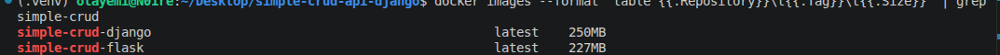

# Django vs Flask: the same REST API built twice

I built the same API from scratch in Django REST Framework and in Flask, each in its own repository, to see what a
framework does for me and what I have to write myself.

- Django: [simple-crud-api-django](https://github.com/Bla-vk/simple-crud-api-django)
- Flask: [simple-crud-api-flask](https://github.com/Bla-vk/simple-crud-api-flask)

## The task
Locations and Items with full CRUD under `/api/v1/`, 20 items per page, filtering items by location, validation errors
returned as 400, unique location names, cascade delete, a `/health/` endpoint, automated tests, a Docker image run by
gunicorn as a non-root user, and a GitHub Actions workflow that tests and builds the image on every pull request.

## At a glance
Counts below were measured from the two repositories.

| | Django (+ DRF) | Flask (+ Flask-SQLAlchemy) |
|---|---|---|
| Hand-written application code (models, serializers, views, routes, URLs) | about 60 lines | about 240 lines |
| Test code | 137 lines | 152 lines |
| Number of tests | 17 | 17 |
| Direct dependencies | 3 (Django, DRF, gunicorn) | 3 (Flask, Flask-SQLAlchemy, gunicorn) |
| Packages pinned in `requirements.txt` | 5 | 11 |
| Test command | `python manage.py test` | `pytest` |
| Time for the 17 tests to run locally | 0.15 s | 7.6 s (whole pytest session) |
| GitHub Actions: `test` job | 10 s | 11 s |
| GitHub Actions: `docker-build` job | 16 s | 19 s |
| Time to a working API with tests (approximate) | about 2 hours | about 1 hour |
| Docker image size (on disk) | 250 MB | 227 MB |
| Docker image size (compressed content) | 53.7 MB | 54.1 MB |

The time row comes from my timestamps: about two hours from creating the Django virtualenv to passing tests, and about
an hour for Flask. Flask was faster partly because I had already built the same API once in Django and knew what to
write. Both CI workflows passed on `main` after the final merges.

Line counts exclude generated files (migrations, `settings.py`, `asgi.py`, `wsgi.py`). The Django settings file is
134 lines, almost all of it generated, and I changed only a handful of them (secret key, debug flag, allowed hosts,
installed apps, pagination).

## What the framework did for me
**Django** gave me, without my writing it:
- the database tables from my models, through migrations
- the unique-name rule and the foreign key, with both turning into correct 400 responses automatically
- a serializer that validates input and builds the response
- a router that created every list, detail, create, update and delete URL from one class
- pagination, from two lines of settings
- cascade delete, from `on_delete=models.CASCADE`
- a test runner that builds and removes a temporary database

The whole API is a 21-line models file, a 13-line serializers file and a 19-line views file.

**Flask** gave me a request, a response and a routing decorator, and I wrote the rest myself: the application factory,
the models and the cascade, input validation and the 400 error format, the duplicate-name check, the 404 for a missing
item or a page beyond the end, and the pagination response (`count`, `pages`, `page`, `results`). That made the routes
file about 175 lines, roughly nine times the size of the Django views file.

## Where each one bit me
- **Django:** The settings file refuses to start without `DJANGO_SECRET_KEY`, which is what I wanted, but it showed up
  as a `KeyError` in every new terminal until I set the variable. A request from `127.0.0.1` was rejected with
  `DisallowedHost` because my default `ALLOWED_HOSTS` only had `localhost`. A capitalisation typo
  (`jsonResponse` instead of `JsonResponse`) stopped the server from starting. I also committed `.venv` and
  `db.sqlite3` before the `.gitignore` worked, and had to stop tracking them with `git rm --cached`.
- **Flask:** The Dockerfile was not saved at first, so the first build said it could not find one. A missing pair of quotes on the config key (`SQLALCHEMY_DATABASE_URI`) crashed the factory. Running two
  gunicorn workers made both call `db.create_all()` at once on a fresh database, and one failed with
  `table location already exists`. Loading the app once with `--preload` fixed it. This is a problem Django never
  showed me, because migrations run once as a separate step.

## Testing
Both suites cover the same cases: create, list, retrieve, update and delete, duplicate and missing fields, an unknown
location, cascade delete, filtering, pagination and the health check.

Django's `APITestCase` creates and destroys a test database for me and gives each test a clean one. In Flask I wrote a
fixture that builds a new app on an in-memory SQLite database for every test, which is a few lines but I had to know to
do it. The pytest tests are plain functions with `assert`, which I found easier to read; the Django tests needed
`self.assertEqual` calls.

## Docker and CI
The first Django image build took about 70 seconds from a cold cache, and a rebuild after fixing a typo in the
Dockerfile took under 25 seconds, because Docker reused every unchanged layer. Putting `COPY requirements.txt` and the
`pip install` before `COPY . .` is what makes that work. A typo in a Dockerfile (`chwon` for `chown`, and a single
dash in `--create-home`) only showed up at build time, and the `docker-build` job in CI catches that kind of mistake
on every pull request. A scan of the `python:3.12-slim` base image reports a couple of OS-level findings with no code
of mine involved, which I treated as a known limit rather than something to fix in the app.

The two images are close in size: 250 MB for Django and 227 MB for Flask on disk, and about 54 MB each as compressed
content (what is actually pushed to a registry). Most of that is the `python:3.12-slim` base, not my code. `docker
history` shows the Debian and Python layers alone come to about 134 MB, while my own application layers are a few
hundred kilobytes.

## Deployment
Both use the same pattern: a `python:3.12-slim` image, a non-root user, gunicorn on port 8000, and the same CI workflow
(tests, then a Docker build). The differences are small. Django runs `migrate` before gunicorn starts, so the tables
exist before any worker boots. Flask creates the tables when the app loads, which is why it needed `--preload`. Flask
installs `requirements-dev.txt` in CI to get pytest; Django needs only `requirements.txt`.

## Which I would choose
For a small API that I need to finish quickly, Django with DRF: the same behaviour took roughly a quarter of the code,
and the places I could get things wrong (validation, constraints, pagination, cascade) were handled by tested framework
code. I would pick Flask when I want a very small service, or when I want to control every layer, and I would add
Flask-Migrate and a validation library rather than hand-writing everything again. Building Django first and Flask
second was useful, because the Flask version made visible everything Django had been doing for me.

## What I would do next
- Replace SQLite with PostgreSQL on RDS, so data survives a task being replaced on ECS.
- Add Flask-Migrate to the Flask version, so schema changes are managed instead of `create_all()`.
- Add authentication to both.
- Deploy one of them through the existing ECS pipeline.
